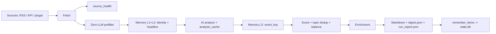

# Fork architecture

This fork (`Gfermoto/Horizon`) turns upstream Horizon into a **signal monitoring
and anti-spam digest engine**. Upstream remains the home of the project; this
document explains what we added, why, and where the boundary with the closed
product (`Gfermoto/Dawnwire`) sits.

## What this engine guarantees

1. **A story is published once.** Identity is checked on three levels: platform
   identity (`canonical_key`), normalized URL, near-duplicate headline, then the
   AI-produced `event_key`. Reprints from another outlet do not ship again.
2. **An amendment is not a duplicate.** When the same identity returns with
   different content (tender price change, corrected deadline), the item is
   emitted with `is_update: true` instead of being silently dropped.
3. **A broken source cannot take the run down.** Per-source health is recorded,
   repeated failures park the source, and `partial_failure` is a normal outcome.
4. **A run cannot spend more than its budget.** Token and cost ceilings gate the
   paid stages; the digest is marked `budget_truncated` instead of failing.
5. **Downstream systems read JSON, not Markdown.** `digest.json` is versioned and
   carries every field a publisher, CRM or tender dashboard needs.

## Data flow



## Storage

Everything durable lives in `{data_dir}/state.db` (SQLite, WAL):

| Table | Purpose |
|-------|---------|
| `published_events` | Three-level memory; keeps content hashes so amendments are detectable |
| `analysis_cache` | LLM results keyed by content hash + profile, TTL configurable |
| `source_health` | Consecutive failures, cooldown, latency, totals |

Markdown digests remain the human artefact and a bootstrap source: a fresh
install with existing `horizon-*.md` files imports them into `published_events`
on its first run.

## Configuration additions

```jsonc
{
  "collection": {
    "memory_days": 30,
    "state_enabled": true,
    "max_consecutive_failures": 5,
    "cooldown_base_hours": 6,
    "tolerate_total_failure": false,
    "must_match": ["мирэа", "44-ФЗ"],
    "exclude_patterns": ["реклама", "промокод"],
    "min_content_chars": 200,
    "max_items_to_analyze": 80,
    "analysis_cache_ttl_hours": 72
  },
  "ai": {
    "max_total_tokens": 400000,
    "max_cost_usd": 2.0,
    "usd_per_million_tokens": 1.0
  },
  "digest": {
    "export_json": true,
    "write_run_report": true
  }
}
```

## Structured output

`horizon-YYYY-MM-DD-{lang}.json` (`schema_version: 1`):

```jsonc
{
  "schema_version": 1,
  "date": "2026-11-19",
  "language": "ru",
  "totals": {"fetched": 214, "selected": 6, "memory_skipped": 31},
  "budget": {"max_total_tokens": 400000, "truncated": false},
  "sources_health": [{"source_key": "RSS Feeds", "consecutive_failures": 0}],
  "items": [
    {
      "id": "rss:article:123",
      "entity_kind": "tender",
      "is_update": false,
      "canonical_key": "0173100000123000001",
      "title": "Капитальный ремонт школы № 12",
      "url": "https://tenders.example/notice/1",
      "score": 9,
      "event_key": "tender 0173100000123000001 капремонт",
      "metadata": {"nmck": 12500000, "customer": "ГБОУ Школа № 12"}
    }
  ]
}
```

`run_report.json` is overwritten each run and records counters, per-source fetch
outcomes, health rows, token usage and budget state — enough to answer "why was
this digest short?" without reading logs.

## Writing a scraper plugin

Plugins live in their own package and are discovered through entry points, so a
private connector never lands in this repository.

```toml
# pyproject.toml of your package
[project.entry-points."horizon.scrapers"]
tenders = "my_connector:scraper_factory"
```

```python
# my_connector/__init__.py
import httpx
from src.scrapers.base import BaseScraper, FetchResult
from src.models import ContentItem, SourceType


class TenderScraper(BaseScraper):
    async def fetch(self, since) -> FetchResult:
        result = FetchResult()
        await result.collect("tenders", self._fetch(since))
        return result

    async def _fetch(self, since):
        response = await self.client.get(self.config["url"])
        response.raise_for_status()
        return [
            ContentItem(
                id=f"tenders:{row['regNumber']}",
                source_type=SourceType.RSS,
                title=row["purchaseName"],
                url=row["detailUrl"],
                published_at=parse(row["publishDate"]),
                canonical_key=row["regNumber"],
                entity_kind="tender",
                metadata={"nmck": row["maxPrice"]},
            )
            for row in response.json()["items"]
        ]


def scraper_factory(config, http_client: httpx.AsyncClient) -> BaseScraper:
    return TenderScraper(config, http_client)
```

Then reference it from config — no Horizon changes needed:

```jsonc
{
  "sources": {
    "custom": [
      {"type": "tenders", "name": "Tenders 44-FZ", "profile": "tender-radar",
       "config": {"url": "https://api.example/items"}}
    ]
  }
}
```

### Declarative sources instead of code

For a plain JSON endpoint, `type: "json_feed"` needs no package at all:

```jsonc
{
  "type": "json_feed",
  "name": "Open registry",
  "config": {
    "url": "https://api.example/items",
    "items_path": "data.items",
    "id_field": "regNumber",
    "title_field": "purchaseName",
    "url_field": "detailUrl",
    "date_field": "publishDate",
    "canonical_key_field": "regNumber",
    "entity_kind": "tender",
    "metadata_fields": {"nmck": "maxPrice", "customer": "customer.fullName"}
  }
}
```

## Open engine vs closed product

| Concern | Where it lives |
|---------|----------------|
| Fetching, memory, dedup, budgets, JSON export | this repo (MIT) |
| Declarative JSON sources, plugin API | this repo (MIT) |
| Authenticated platform connectors (tenders, paid APIs), captcha/proxy handling | closed product |
| Commercial scoring profiles, prompts, vertical logic | closed product |
| Multi-tenant SaaS, billing, cabinet, delivery routing | closed product |

The rule of thumb: if a feature makes *any* digest pipeline more honest,
cheaper or more reliable, it belongs here. If it encodes a commercial edge or a
private credential, it belongs behind the plugin boundary.

## Syncing with upstream

```bash
git remote add upstream https://github.com/Thysrael/Horizon.git
git fetch upstream
git rebase upstream/main
```

General fixes (RSS encoding, extraction resilience, preflight checks) are good
candidates for upstream pull requests; the memory/budget layer is deliberately
fork-specific.
